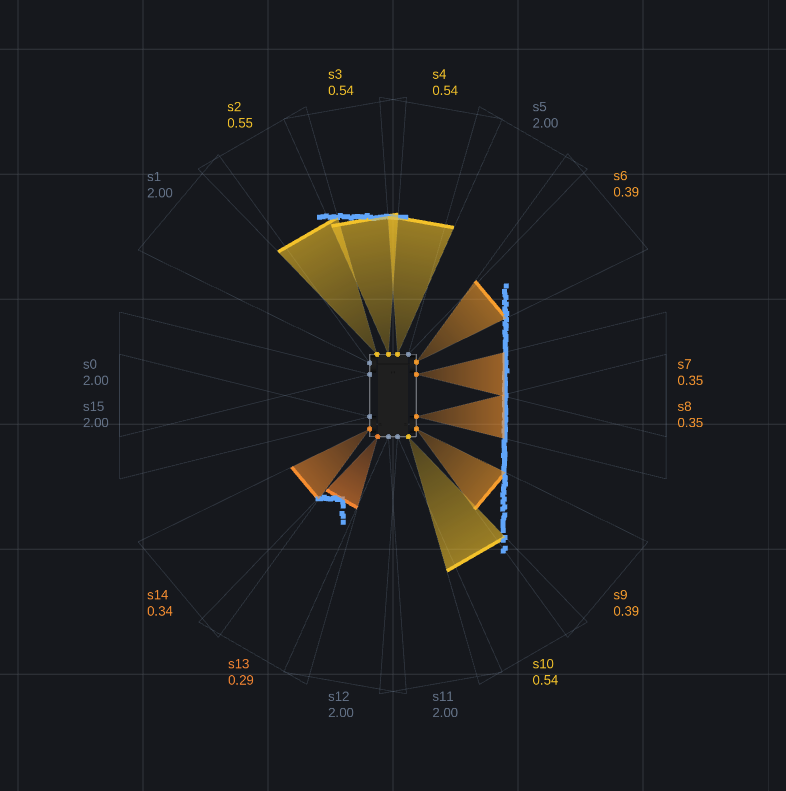

# Kit Mahasiswa — Robot JetRacer ROS 2

Robot ini adalah **host sensor & aktuator**. Semua sensor dan motor tersedia
sebagai topik ROS 2 Humble, dan **sistem navigasinya kalian buat di PC
kalian sendiri**. PC dan robot tersambung lewat jaringan (ROS 2 multi-machine,
DDS).

```
 PC mahasiswa (kit ini)                          Robot (Jetson Nano)
 ┌──────────────────────────┐   WiFi / LAN    ┌──────────────────────────┐
 │ node navigasi kalian     │ ── /cmd_vel ──▶ │ motor + kemudi           │
 │ SLAM, Nav2, RViz         │ ◀── /scan ───── │ LiDAR RPLIDAR A1         │
 │                          │ ◀── /odom, /imu │ encoder, IMU             │
 │                          │ ◀── /camera/... │ kamera                   │
 └──────────────────────────┘                 └──────────────────────────┘
```

---

## 1. Kebutuhan PC

- **Linux** dengan **Docker Engine** (Ubuntu, Debian, Fedora, Arch, dll.).
  Ruang disk sekitar 6 GB untuk image ROS 2.
- **Bukan Docker Desktop (Windows/macOS).** Docker Desktop menjalankan
  container di dalam VM, sehingga `--net=host` tidak benar-benar memakai
  jaringan PC dan DDS tidak bisa menemukan robot. Di Windows, pakai Ubuntu
  dual-boot atau PC lab Linux.
- Terhubung ke jaringan yang bisa mencapai robot: tes dengan `ping <IP robot>`.

### Cara cepat: `setup.sh` (sekali saja)

```bash
./setup.sh                                  # subnet robot default 10.17.36.0/22
./setup.sh --subnet <subnet robot>          # kalau subnet beda (tanya dosen)
./setup.sh --robot-ip 10.17.36.90           # sekaligus tes sambungan ke robot
```

Script ini memasang Docker Engine, memasukkan kalian ke grup `docker`,
membangun image ROS 2 (Nav2, slam_toolbox, teleop, RViz; ±5 GB unduhan),
membuka firewall (ufw/firewalld), dan menyiapkan folder `ros2_ws/src` dan
`peta/`. Script ini aman dijalankan ulang. Distro yang didukung: Ubuntu,
Debian, Fedora, dan Arch. Kalau script meminta, **logout & login lagi**
setelah selesai.

Kalau mau memasang manual, ikuti langkah di bawah.

Pasang Docker (Ubuntu): `sudo apt install docker.io`, lalu
`sudo usermod -aG docker $USER`, lalu **logout & login lagi**.

### Firewall PC

Robot harus bisa **mengirim** data ke PC kalian lewat UDP. Kalau PC memakai
`ufw` (cek: `sudo ufw status`), buka port DDS untuk subnet robot:

```bash
# Ganti 10.17.36.0/22 dengan subnet jaringan robot (tanya dosen).
# Port 17900-17999 = ROS_DOMAIN_ID 42.
sudo ufw allow proto udp from 10.17.36.0/22 to any port 17900:17999
```

Tanpa ini: `ros2 topic list` di PC hanya menampilkan `/parameter_events`
dan `/rosout`.

---

## 2. Menyambung ke robot

1. Nyalakan robot. Tunggu sekitar 1 menit sampai **IP robot muncul di layar
   OLED**-nya.
2. Di PC, dari folder kit ini:

```bash
ROBOT_IP=10.17.36.90 ./ros.sh ros2 topic list     # IP dari OLED
```

Pertama kali dijalankan, image ROS 2 dibangun otomatis (sekitar 5 GB unduhan,
sekali saja). Topik yang harus muncul:

| Topik | Tipe | Arah | Keterangan |
|---|---|---|---|
| `/cmd_vel` | `geometry_msgs/Twist` | PC → robot | `linear.x` = v (m/s), `angular.z` = ω (rad/s) |
| `/odom` | `nav_msgs/Odometry` | robot → PC | 50 Hz, dari encoder roda (dihitung firmware) |
| `/imu` | `sensor_msgs/Imu` | robot → PC | 50 Hz, MPU9250 |
| `/scan` | `sensor_msgs/LaserScan` | robot → PC | ~7.8 Hz, 360 sampel, 0.15–12 m |
| `/cmd_wheel_vel` | `std_msgs/Float32MultiArray` | PC → robot | **mode Pioneer P3-DX**: `[φL, φR]` kecepatan sudut roda P3-DX (rad/s), lihat bagian 4 |
| `/sonar` | `std_msgs/Float32MultiArray` | robot → PC | ~7.8 Hz, 16 sonar Pioneer P3-DX dari LiDAR, `data[0..15]` = sensor 0..15 (m), tidak ada deteksi = 2.0 |
| `/sonar/markers` | `visualization_msgs/MarkerArray` | robot → PC | gambar ke-16 sonar untuk RViz (display **MarkerArray**), lihat bagian 4 |
| `/camera/image_raw/compressed` | `sensor_msgs/CompressedImage` | robot → PC | JPEG 640×360, 15 fps |
| `/battery` | `sensor_msgs/BatteryState` | robot → PC | 1 Hz, baterai 3S (9.0–12.6 V) |
| `/tf`, `/tf_static` | | robot → PC | `odom → base_footprint → base_link → {laser_frame, imu_link, camera_link}` |
| `/motor/{lvel,rvel,lset,rset}` | `std_msgs/Int32` | robot → PC | kecepatan roda terukur & setpoint (satuan firmware, ~110 per m/s) |

Perintah lain:

```bash
ROBOT_IP=10.17.36.90 ./ros.sh                     # shell ROS 2 interaktif
ROBOT_IP=10.17.36.90 ./ros.sh rviz2               # RViz
ROBOT_IP=10.17.36.90 ./ros.sh rviz2 -d /workspace/rviz/sonar.rviz   # RViz, tampilan sonar
export ROBOT_IP=10.17.36.90                       # supaya tidak diulang terus
```

Folder kit ini ter-mount di **`/workspace`** di dalam container. Simpan kode
dan peta kalian di sini supaya tidak hilang saat container ditutup.

---

## 3. Sifat robot yang harus kalian tahu

- **Mobil Ackermann** (seperti mobil sungguhan): roda belakang = penggerak,
  roda depan = kemudi.
  - **Tidak bisa berputar di tempat.** `linear.x = 0` membuat robot diam,
    berapa pun `angular.z`-nya. Untuk berbelok, robot harus maju atau mundur.
  - Firmware menghitung sendiri sudut kemudi dan beda kecepatan roda
    kiri/kanan dari `(v, ω)`.
  - Radius belok minimum terbatas, jadi ω yang terlalu besar dibanding v
    akan "mentok". Untuk Nav2, pilih controller yang mendukung Ackermann
    (mis. Regulated Pure Pursuit) dan batasi `min_turning_radius`.
- **Batas kecepatan driver:** |v| ≤ 0.5 m/s, |ω| ≤ 2.0 rad/s. Nilai lebih
  besar dipotong.
- **Pengaman:** kalau `/cmd_vel` berhenti datang selama **0.5 detik**, robot
  berhenti sendiri. Node kalian harus mengirim `/cmd_vel` terus-menerus
  (mis. 10 Hz) selama ingin bergerak.
- **LiDAR & kamera menyala sesuai permintaan:** motor LiDAR dan kamera hanya
  aktif kalau ada yang berlangganan. Scan pertama datang **sekitar 1.5 detik**
  setelah kalian mulai berlangganan. Itu normal.
- **Sonar Pioneer P3-DX (`/sonar`):** robot mengubah LiDAR menjadi 16 sonar
  yang meniru sensor ultrasonik P3-DX di CoppeliaSim (diukur dari scene
  kelas). Indeks sama dengan `getDistance()`: 0..7 depan
  `90 50 30 10 -10 -30 -50 -90`°, 8..15 belakang `-90 -130 -150 -170 170 150 130 90`°
  (0 = depan, + = kiri). Sensor "menempel" di **tepi badan** robot, jadi
  nilainya = jarak dari bemper sepanjang arah sensor. Cone ±14°, jangkauan
  0.045–1.0 m, **tidak ada deteksi = 2.0**. Seperti `/scan`, data pertama
  datang sekitar 1.5 detik setelah subscribe.
- **QoS:** semua topik robot memakai **Reliable**, jadi cocok dengan QoS
  default (`10`) maupun `qos_profile_sensor_data`.
- **Satu robot, satu pengendali.** Kalau dua PC mengirim `/cmd_vel`
  bersamaan, robot mengikuti pesan yang paling baru dan bergerak tidak
  karuan. Sepakati siapa yang memegang `/cmd_vel`.

---

## 4. Contoh

### Mode Pioneer P3-DX — `lib/p3dx.py` (program CoppeliaSim → robot)

Program kelas untuk P3-DX di CoppeliaSim (`main.py` + `m_p3dx.py`) bisa
dipindah ke robot dengan teori dan fungsi yang sama:

| CoppeliaSim | Robot (`import p3dx`) |
|---|---|
| `import sim`, `import m_p3dx as p3dx` | `import p3dx` |
| `clientID = connect()` (sim.simxStart) | `clientID = p3dx.connect()` |
| `p3dx.getSensorsHandle`, `getMotorHandle`, `getDistance`, `setWheelVel`, `robotWheelKine` | **sama** |
| `sim.simxFinish` | `p3dx.disconnect(clientID)` |
| modul `keyboard` | `k = p3dx.tombol()` → `'w'`, `'a'`, ... atau `''` (tanpa Enter; terminal diurus library) |

```bash
./ros.sh python3 /workspace/contoh/test.py     # angkat roda dulu!
```

[`contoh/test.py`](contoh/test.py) adalah program terkecil: sambung ke robot,
tampilkan ke-16 sonar, dan gerakkan robot dengan `w`/`s`/`a`/`d` (tahan
tombolnya). `q` atau Ctrl-C = keluar, robot berhenti. Pakai sebagai titik
awal program kalian sendiri.

Cara kerjanya: `setWheelVel` mengirim kecepatan roda P3-DX `[φL, φR]` ke
`/cmd_wheel_vel`. Robot menghitung gerak P3-DX yang sebenarnya
(r = 0.0975 m, jarak roda 0.331 m, sama dengan model di Coppelia), lalu
menjalankannya dengan kemudi Ackermann. Gain yang sudah di-tuning di
Coppelia tetap bermakna sama.

Bedanya dengan P3-DX (mobil Ackermann, bagian 3):
- **Tidak bisa berputar di tempat.** `φL = −φR` → robot diam. Tombol a/d di
  contoh dibuat maju sambil belok.
- Radius belok minimum terbatas; belok tajam "mentok".
- Perintah roda terakhir tetap berlaku seperti di Coppelia, tetapi robot
  berhenti begitu program selesai/crash/Ctrl-C.

Saat **mundur**, `setWheelVel`/`robotWheelKine` tetap memutar robot ke arah
yang sama dengan P3-DX (ω > 0 = berlawanan jarum jam). Ini berbeda dengan
`/cmd_vel` langsung: di sana `angular.z` adalah arah kemudi, jadi saat mundur
dengan `angular.z > 0` badan robot berputar **searah** jarum jam, seperti
mobil yang mundur dengan setir ke kiri.

**Sonar di node ROS 2 sendiri.** Tidak perlu mengubah `/scan` menjadi sonar
di program kalian — robot sudah mengirimnya di `/sonar`:

```python
from std_msgs.msg import Float32MultiArray

self.create_subscription(Float32MultiArray, '/sonar', self.sonar_callback, 10)

def sonar_callback(self, msg):
    self.sensor = list(msg.data)        # sensor[0..15]; tidak ada deteksi = 2.0
    d = min(self.sensor[3], self.sensor[4])      # materi: d = min(S4, S5)
    q = self.sensor[5] - self.sensor[2]          #         θ = S6 − S3
```

Slide menomori sonar dari 1 (S1..S16); program dan topik dari 0
(`sensor[0..15]`, label `s0..s15` di RViz). Jadi S4 di slide = `sensor[3]`.

### Melihat sonar di RViz — `rviz/sonar.rviz`

```bash
./ros.sh rviz2 -d /workspace/rviz/sonar.rviz
```



*(contoh: kotak di depan, dinding di kanan, benda dekat di kiri-belakang)*

Robot dilihat dari atas, **depan robot = atas layar**:

- **garis tipis** = daerah deteksi tiap sonar (cone ±14° sampai 1.0 m, mulai
  dari tepi badan robot);
- **segitiga berwarna** = sonar yang mendeteksi sesuatu, digambar sampai jarak
  terbaca. Merah = dekat, kuning = sedang, hijau = jauh;
- **label** `s3` / `0.54` = indeks sonar dan nilai yang dibaca program.
  Abu-abu `2.00` = tidak ada deteksi;
- **titik biru** = LiDAR asli (`/scan`), untuk membandingkan.

Semua digambar robot di satu topik, `/sonar/markers`. Di config RViz kalian
sendiri cukup **Add → By topic → /sonar/markers → MarkerArray**. Bagian
gambarnya bisa dimatikan satu per satu di *Namespaces* (misalnya
`sonar/jangkauan` kalau terasa ramai).

### Gaya ROS 1 (rospy) — `lib/ros1_style.py`

Kalau lebih suka loop `while` seperti di ROS 1, tanpa class:

```python
import ros1_style as rospy
from geometry_msgs.msg import Twist
from sensor_msgs.msg import LaserScan

jarak = [None]
def on_scan(msg):
    jarak[0] = min(r for r in msg.ranges if r > 0)   # benda terdekat, arah mana saja

rospy.init_node("tes_saya")
pub = rospy.Publisher("/cmd_vel", Twist)
rospy.Subscriber("/scan", LaserScan, on_scan)
rate = rospy.Rate(10)                 # 10 Hz

while not rospy.is_shutdown():
    rospy.loginfo("jarak = %s" % jarak[0])
    rate.sleep()
```

Simpan di mana saja di folder kit, lalu jalankan dengan
`./ros.sh python3 /workspace/<file>.py`. `import ros1_style` selalu tersedia
di `ros.sh`.

| rospy (ROS 1) | `ros1_style` |
|---|---|
| `rospy.init_node`, `Rate`, `is_shutdown`, `sleep`, `spin` | sama |
| `rospy.Publisher(topic, Tipe, queue_size=10)` | sama (`queue_size` opsional) |
| `rospy.Subscriber(topic, Tipe, callback)` | sama |
| `rospy.wait_for_message(topic, Tipe, timeout)` | sama, tapi mengembalikan `None` saat timeout |
| `rospy.loginfo / logwarn / logerr` | sama |
| `rospy.get_param` | belum ada; pakai `rospy.node.declare_parameter(...)` |

- Callback subscriber jalan di thread latar belakang, sama seperti rospy.
- **Ctrl-C** membuat loop selesai dengan rapi. Ctrl-C kedua memaksa berhenti.
- Saat program selesai, setiap Publisher `Twist` otomatis mengirim Twist nol,
  sehingga robot berhenti.
- `rospy.node` adalah node rclpy biasa, kalau butuh fitur ROS 2 lain.
- Gaya ini untuk belajar dan program sederhana. Untuk paket dengan launch file
  (bagian 5), pakai gaya class/timer (node rclpy biasa).

### Teleop keyboard

```bash
./ros.sh ros2 run teleop_twist_keyboard teleop_twist_keyboard --ros-args -p speed:=0.15 -p turn:=0.8
```

Tombol `i` maju, `,` mundur, `u`/`o` maju belok kiri/kanan, `k` berhenti.
**Tahan tombolnya**: robot berhenti 0.5 s setelah tombol dilepas.

### Peta & lokalisasi — slam_toolbox (`nav/`)

Dua tahap, keduanya jalan di PC kalian. Parameter bersama ada di
[`nav/slam.yaml`](nav/slam.yaml).

**Tahap 1 — Mapping (sekali per ruangan)**

1. Letakkan robot di **titik awal** yang mudah diulang (mis. tanda selotip di
   lantai, robot menghadap dinding tertentu). Titik ini menjadi acuan
   lokalisasi nanti.
2. Shell 1 — mulai mapping:
   ```bash
   ./ros.sh ros2 launch /workspace/nav/mapping.launch.py
   ```
3. Shell 2 — `./ros.sh rviz2`. Set Fixed Frame `map`, lalu tambahkan display
   **Map** (`/map`), **LaserScan** (`/scan`), dan **TF**.
4. Shell 3 — jalankan robot **pelan** (≤ 0.2 m/s) keliling ruangan dengan
   teleop. Lewati tiap area dari beberapa arah, dan kembali ke titik awal di
   akhir (membantu loop closure).
   > Peta baru terisi setelah robot **bergerak**. Robot diam = peta hampir
   > kosong, karena sel harus terlihat dari beberapa pose.
5. Simpan:
   ```bash
   ./ros.sh /workspace/nav/simpan_peta.sh lab
   ```
   Hasilnya ada di folder `peta/`: `lab.posegraph` + `lab.data` (untuk
   lokalisasi) dan `lab.pgm` + `lab.yaml` (peta gambar untuk Nav2/laporan).

**Tahap 2 — Lokalisasi (setiap kali robot dipakai di ruangan itu)**

1. Letakkan robot **di titik awal yang sama dengan saat mapping**, dengan
   arah yang sama.
2. Jalankan:
   ```bash
   ./ros.sh ros2 launch /workspace/nav/localization.launch.py peta:=lab
   ```
   Robot di tempat lain? Beri posenya, misalnya `x:=1.2 y:=0.5 theta:=1.57`,
   atau pakai **2D Pose Estimate** di RViz.
3. Lihat posisi robot di peta:
   ```bash
   ./ros.sh python3 /workspace/nav/posisi_robot.py
   ```
   Posisi ada di TF `map → base_footprint`. slam_toolbox di Humble **tidak**
   menerbitkan topik pose. Lihat [`nav/posisi_robot.py`](nav/posisi_robot.py)
   untuk cara membacanya dari kode.

Scan matching hanya mengoreksi kesalahan pose awal yang **kecil** (puluhan
cm, belasan derajat). Pose awal yang jauh salah = robot "tersesat"; beri pose
yang benar lewat RViz.

### Navigasi — Nav2

Image kit sudah berisi `navigation2` dan `nav2_bringup`. Frame yang dipakai:
`map` (dari lokalisasi di atas) → `odom` → `base_footprint`, scan `/scan`, odometri `/odom`, perintah
`/cmd_vel`. Ingat batasan Ackermann di bagian 3.

---

## 5. Membuat paket ROS 2 sendiri

Satu file `.py` seperti contoh di atas cukup untuk percobaan. Untuk tugas yang
lebih besar (beberapa node, launch file, parameter YAML), buat **paket ROS 2**
di workspace `ros2_ws/` di dalam folder kit ini.

### Membuat paket (sekali)

```bash
./ros.sh                                  # masuk shell ROS 2
mkdir -p /workspace/ros2_ws/src && cd /workspace/ros2_ws/src
ros2 pkg create --build-type ament_python --license MIT \
    --dependencies rclpy geometry_msgs sensor_msgs nav_msgs \
    --node-name node_saya tugas_saya
cd /workspace/ros2_ws
colcon build --symlink-install
exit
```

Hasilnya:

```
kit-mahasiswa/ros2_ws/
├── src/tugas_saya/              ← kode kalian (simpan / masukkan ke git)
│   ├── package.xml              dependensi paket
│   ├── setup.py                 daftar node (entry_points) & file data
│   └── tugas_saya/node_saya.py  kode node
├── build/  install/  log/       ← hasil build (boleh dihapus, jangan di-git)
```

Edit kode dengan editor apa saja **di PC** (VS Code, dll.): folder ini sama
dengan `/workspace/ros2_ws` di dalam container.

### Menjalankan

```bash
./ros.sh ros2 run tugas_saya node_saya
./ros.sh ros2 run tugas_saya node_saya --ros-args -p kecepatan:=0.1
```

`ros.sh` otomatis memuat `ros2_ws/install/setup.bash`, jadi paket kalian
langsung dikenali, baik lewat `./ros.sh <perintah>` maupun di shell `./ros.sh`.

### Kapan harus `colcon build` lagi?

Karena memakai `--symlink-install`:

| Perubahan | Perlu build ulang? |
|---|---|
| Mengubah isi file `.py` yang sudah ada | **Tidak**, langsung jalankan lagi |
| Menambah node baru, file launch, atau file YAML | **Ya** |
| Mengubah `setup.py` atau `package.xml` | **Ya** |
| Membuat paket baru | **Ya** |

Build ulang: `./ros.sh bash -c "cd /workspace/ros2_ws && colcon build --symlink-install"`.

### Menambah node kedua

1. Buat `ros2_ws/src/tugas_saya/tugas_saya/node_kedua.py` dengan fungsi `main()`
   (salin pola dari `node_saya.py`).
2. Daftarkan di `setup.py`, bagian `entry_points`:
   ```python
   'console_scripts': [
       'node_saya = tugas_saya.node_saya:main',
       'node_kedua = tugas_saya.node_kedua:main',
   ],
   ```
3. `colcon build --symlink-install`, lalu `./ros.sh ros2 run tugas_saya node_kedua`.

### Launch file & parameter YAML

Untuk menjalankan beberapa node sekaligus, buat folder `launch/` dan `config/`
di dalam paket, lalu daftarkan di `setup.py` supaya ikut ter-install:

```python
import os
from glob import glob
...
    data_files=[
        ('share/ament_index/resource_index/packages', ['resource/' + package_name]),
        ('share/' + package_name, ['package.xml']),
        (os.path.join('share', package_name, 'launch'), glob('launch/*.launch.py')),
        (os.path.join('share', package_name, 'config'), glob('config/*.yaml')),
    ],
```

Contoh `launch/tugas.launch.py`:

```python
import os
from ament_index_python.packages import get_package_share_directory
from launch import LaunchDescription
from launch_ros.actions import Node


def generate_launch_description():
    param = os.path.join(get_package_share_directory("tugas_saya"), "config", "param.yaml")
    return LaunchDescription([
        Node(package="tugas_saya", executable="node_saya", parameters=[param], output="screen"),
    ])
```

`config/param.yaml` (nama node harus sama dengan `super().__init__("...")`):

```yaml
node_saya:
  ros__parameters:
    kecepatan: 0.15
```

Build ulang, lalu: `./ros.sh ros2 launch tugas_saya tugas.launch.py`.

### Catatan

- **Jangan** menyalin `build/` dan `install/` ke PC lain atau ke robot.
  Cukup bawa `src/`, lalu build ulang di sana.
- Build error aneh setelah mengganti nama atau menghapus file? Hapus hasil
  build lalu build ulang: `rm -rf ros2_ws/build ros2_ws/install ros2_ws/log`.
- Paket C++ (`--build-type ament_cmake`) juga bisa. Alurnya sama, tapi
  **setiap** perubahan kode perlu `colcon build`.

---

## 6. Kalau ada masalah

| Gejala | Penyebab | Solusi |
|---|---|---|
| `ros2 topic list` hanya `/parameter_events` dan `/rosout` | firewall PC memblokir UDP dari robot; IP robot salah; `ROS_DOMAIN_ID` beda | aturan ufw (bagian 1); cek IP di OLED; domain = 42 |
| Node kalian sendiri di PC yang sama tidak saling melihat | firewall memblokir discovery lokal | pakai `ros.sh` terbaru (sudah menambahkan peer `127.0.0.1`) |
| `/scan` kosong beberapa detik pertama | LiDAR baru dinyalakan karena ada subscriber | tunggu ~1.5 s |
| Robot tidak bergerak dengan `angular.z` saja | Ackermann: v = 0 → berhenti | beri `linear.x` juga |
| Robot berhenti-berhenti sendiri | `/cmd_vel` dikirim < 2 kali per detik | kirim ≥ 10 Hz |
| RViz: display baru diam tanpa error | Fixed Frame tidak ada (mis. `map` tanpa SLAM) | ganti Fixed Frame ke `odom` |
| Peta hampir kosong | robot tidak bergerak saat mapping | jalankan robot keliling ruangan |
| Lokalisasi: posisi melompat / salah | pose awal salah (robot tidak di titik awal mapping) | letakkan di titik awal, atau 2D Pose Estimate di RViz |
| Docker Desktop (Windows/macOS) tidak melihat robot | `--net=host` tidak didukung penuh | pakai Linux |
| `permission denied while trying to connect to the docker API` | sesi login belum masuk grup `docker` (belum logout/login setelah `setup.sh`), atau `setup.sh` belum dijalankan | jalankan `./setup.sh`, lalu **logout & login** (menutup terminal saja tidak cukup). Sementara: `newgrp docker` di terminal itu |
